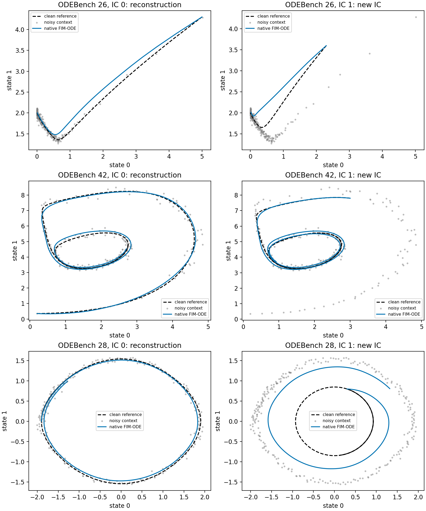

# C80：公开 FIM-ODE 的原生动力学推断与普通辨识控制

完成实际可查询动力学模型的原生执行，而非再将预测器分数解释成物理状态。70个上游源文件与固定 commit/Git blob/SHA256 一致，基础权重51,907,384字节与HF LFS哈希一致，12,968,068参数及所有加载张量逐值核验。完整包正常导入，没有跳过注册、改写 forward、替换模型结构或改动权重。三个预定教程系统、每个两个初值的全部六次原生积分均成功；这不是全文或全 ODEBench 复现。

## 信息与执行合同

上游 OpenFIM commit `cee2bb53be1e8e92b73f98dfdbe3605efc9119cc`；HF模型revision `00875c253d025dd33fd70ae751089b1be3a7c174`；ODEBench revision `91909865498f5d4bd69ea575527fee50ad329ef4`。只下载base配置、safetensors和3.7MB方程/轨迹JSON，全部直接到服务器G；未下载所有适配权重、优化器或预训练数据。公共源代码仅经内存传输并逐文件校验，没有本地结果、数据或权重文件同步。

原生教程固定系统26（LV competition）、42（CDIMA）、28（pendulum），每个使用seed0、第一条轨迹、乘性高斯噪声SD0.03、保留一半采样点。实际 helper 使用 linspace 规则保留256/512点，不应写成随机缺失或伯努利 mask。全部2D状态可见，未来无行动；模型内部按原方法补到3D。每个系统仅第一条含噪路径作为上下文，第二条路径只提供干净初值和评估时间；不提供其未来输出、真向量场或真系数给模型。

IC0的整条路径参与上下文，是重建，不是因果时间预测或独立测试；IC1是同一方程和系数下的新初值。两者分开报告，不混合成泛化指标。三个固定公开演示、一个噪声seed不足以推断整个领域；结果揭示的现象尚未经过独立系统确认。

CPU float32、两线程、仅当前进程efficient-core affinity，Python3.10.20、Torch2.8.0+cu128、NumPy1.26.4、SciPy1.15.3、Transformers4.56.2。完整隔离依赖、版本与导入记录保留。原生 `model_forward` 与教程缓存编码/解码接口的18点查询完全一致、重复查询一致；独立脚本用缓存向量场重新积分全部六条路径，预测逐值差0。这里的CPU执行没有复用历史GPU预测，故不放宽任何旧容差。

## 全部结果

NRMSE = RMSE / std(完整参考轨迹的全部坐标值)，保持原来定义，不是逐坐标标准化误差。该std仅用于评估，未进入模型或控制的选择。各方都获得同一个干净初值与时间网格。

| System | Initial condition role | FIM-ODE | Context-only weak integral | Privileged true equations |
|---|---|---:|---:|---:|
| 26 | Context reconstruction | 0.091907972 | 0.014212417 | 0.000107993 |
| 26 | New IC, same system | 0.128249251 | 0.300991034 | 0.000044540 |
| 42 | Context reconstruction | 0.062642419 | 0.045209422 | 0.000184770 |
| 42 | New IC, same system | 0.158431163 | 0.029382549 | 0.000212279 |
| 28 | Context reconstruction | 0.130034943 | 0.029745426 | 0.000173607 |
| 28 | New IC, same system | 1.621213516 | 0.908761033 | 0.000240981 |

图已在内存中读取服务器原始PNG并做视觉检查，没有保存到本地。它显示摆系统的单条外轨道重建良好，而内侧新轨道错误；不能仅凭轨道图归因为某种独有的潜在机制。

## 普通控制与选择边界

六个原生分数揭示后，单独冻结 `ORDINARY_CONTROL80_V1.md`。这是事后反证，不是独立确认。仅用相同256个含噪上下文点，做标准弱积分向量场回归：三次多项式，或多项式加两坐标的sin/cos；8/16/32间隔梯形积分，ridge三候选、稀疏阈值两候选。每系统12候选在前192点拟合、最后65个可见上下文点验证，选择后用全部256点重拟合。三系统共36候选和3次全上下文拟合，没有神经训练。三者都由上下文选择了trig库。

trig库在阅读公开方程后确定，属于source-informed普通控制，不声称完全无先验或与基础模型预训练成本相同。没有把真实系数、IC1未来轨迹或干净IC0未来标签用于拟合/选择；未继续按外部结果加rational项、调ridge或加候选。所有候选与失败状态保留。

CDIMA新初值被普通回归大幅修复，摆的误差部分下降但仍高，LV新初值反而变差。不能报告普通方法普遍更好，也不能把剩余摆误差直接认定为新机制。候选库失配、单路径信息与归纳先验仍是竞争解释；GP向量场后验、MOD式保持上下文拟合的不同动力学等更强控制本轮没有执行。

真实方程/常数另作特权数值诊断；它们的最大NRMSE约0.000241，支持排除主要的参考身份和积分定义错误。它不是学习基线，也不能证明含噪单路径已足够识别全局动力学。全部18条最终轨迹完整有限，所有数值积分成功。未触发20,000次rhs或绝对状态1e6的预置保护；保护不等于稳定性证明。

## 独立验证与原始产物

重新从公开JSON和seed重建上下文、逐一核对干净参考身份，全部一致。独立计算18条结果36,864个预测/参考标量及36个上下文选择分数，最大差0；三个最终线性模型用不同的augmented least squares重构，最大系数差7.18e-10；六条原生轨迹缓存/直接积分重放差0。源和权重结束时再次核验。

初次普通控制保留了全部结构化候选、系数与预测，但stdout仅留在工具记录。为补齐服务器终端日志，进行了完全相同的单独V2回放，未改协议或选择；全部数组、模型系数和指标逐值相同。它不是额外独立实验或稳定性seed。原始V1产物保留，独立验证和精确回放链均有哈希。

新数据、源、依赖前缀、神经权重和完整数组保留G；GitHub上传作者代码、协议、完整紧凑结果、候选、系数、版本、日志、图和哈希。上传内容不包含大规模信号或神经权重。

## 研究判断

FIM-ODE的原生可查询动力学能力已经实际建立；摆新初值现象也被实际复现，但这没有证明一个未解决、独有且可投稿的新机制问题。C80的独立文献补查找到MOD、GP-ODE、LUNO、SANODEP、Active-SINDy和上下文验证等直接前例，详见 literature_review.md。只重新命名“轨迹外有不确定性”“需要收集信息”“用上下文选适配”不具备所需创新性。

保留这个已资格化底座供后续通用问题使用，停止把当前单个摆的剩余误差作为新架构动机。没有证明所有更高维/部分观测/机制迁移问题已解决，也没有进行未知传感器或行动干预实验。下一项决定性工作必须在事先固定的独立系统和预算下区分信息不足、先验和可修复学习残差，且与强普通方法同信息比较，不能再调这六条演示。C71原预算三种子任务继续运行；当前实际进程确认第一组结束、第二组在训，保留评估未打开。总目标ACTIVE/UNACHIEVED，最终接受研究方向0。
