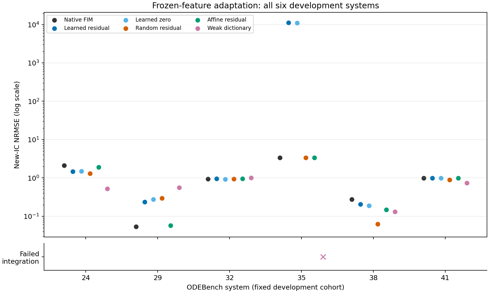

# C81：预训练动力学特征能否提供有效适配方向？

预定门槛未通过，停止这条读出层适配路线，不在相同开发系统上继续调参。 这是通用动力学能力的开发筛查，不是某个真实数据集调优，也不是所有时间序列世界模型的结论。

## 固定的实验与选择

固定 OpenFIM commit `cee2bb53be1e8e92b73f98dfdbe3605efc9119cc`、HF模型revision `00875c253d025dd33fd70ae751089b1be3a7c174` 和 ODEBench revision `91909865498f5d4bd69ea575527fee50ad329ef4`。基础checkpoint有12,968,068参数，保持全部冻结。来源和资产沿用C80哈希，不重复下载。

先依据公开维度、成功标记和512点结构选择系统，排除C80三个教程；开发ID [24, 29, 32, 35, 38, 41]，保留评估ID [25, 30, 33, 36, 39, 43]。保留系统未进行预测评分。本JSON在早期审计解析过，不能声称完全未接触或保证不在作者预训练分布中。该切分是在本轮特征提取和新系统评分之前冻结。

每个系统只有第一条含噪轨迹的256点，3%乘性高斯噪声、seed2026810。所有状态可见，无行动或潜在传感器转移。第一条干净路径为重建，第二条是同方程参数的新初值模拟；双方只获其初值和时间，不获未来。模型的2D物理输出采用原生内部3D补齐和归一化。

原生最后线性层有256个隐藏特征和偏置，共257项。FIM残差、从零拟合、随机残差均有514个可适配系数；仿射残差10个，普通库20或28个。随机特征控制与FIM同特征数，且两者都保留同一个FIM基础场。它们不是全模型随机初始化控制，也未匹配有效秩或离线预训练成本。

每个族都用前192点构建编码、归一化及弱积分拟合，在可见上下文最后65点验证轨迹MSE；再用全256点重建并重拟合。没有把验证点先喂给编码器。四个修正族各3个ridge候选，普通库12候选，每系统24，共144；另36个全上下文模型含6个原生模型。没有新的神经训练。相同RK45容差、20,000 RHS调用/状态绝对值1e6失败保护，无截断裁剪。弱拟合是普通工作回归，不声称精确贝叶斯轨迹后验或校准不确定性。

## 独立新初值的全部NRMSE

NRMSE = RMSE / 完整干净参考全部坐标的合并标准差，只用于评分。

| System | Native | Learned residual | Learned zero | Random residual | Affine residual | Weak dictionary |
|---|---:|---:|---:|---:|---:|---:|
| 24 | 2.094755 | 1.475761 | 1.496325 | 1.309341 | 1.890307 | 0.522274 |
| 29 | 0.053260 | 0.235624 | 0.273152 | 0.297141 | 0.057240 | 0.557872 |
| 32 | 0.943938 | 0.958537 | 0.922340 | 0.942899 | 0.946683 | 0.998059 |
| 35 | 3.391207 | 11264.689243 | 11053.031781 | 3.351483 | 3.388955 | FAIL |
| 38 | 0.277659 | 0.205046 | 0.186938 | 0.062300 | 0.148127 | 0.130233 |
| 41 | 0.989810 | 0.988138 | 0.980045 | 0.886689 | 0.993253 | 0.731283 |

预训练残差相对原生改善 **3/6**；相对随机残差/仿射残差/普通库的逐系统最小误差改善 **0/6**。此逐系统下包络仅是诊断门槛，依赖评分结果，不是可部署的无标签选择器。中位配对NRMSE比为 **3.058444**；保留所有原生成功轨迹：**True**。未只汇总成功结果；全部失败/部分积分原数组和日志保留。

## 观察路径重建，单独报告

| System | Native | Learned residual | Learned zero | Random residual | Affine residual | Weak dictionary |
|---|---:|---:|---:|---:|---:|---:|
| 24 | 0.259841 | 0.010072 | 0.009096 | 0.012326 | 0.013171 | 0.007311 |
| 29 | 0.035359 | 0.029865 | 0.029789 | 0.046952 | 0.023374 | 0.021522 |
| 32 | 0.321930 | 0.014958 | 0.013511 | 0.015329 | 0.248698 | 0.103727 |
| 35 | 0.102179 | 0.046860 | 0.041496 | 0.163131 | 0.107752 | 0.138502 |
| 38 | 0.088909 | 0.015798 | 0.016159 | 0.015775 | 0.125524 | 0.111385 |
| 41 | 0.270990 | 0.032687 | 0.031279 | 0.017963 | 0.383221 | 1.389119 |

低重建误差本身不足以证明转移规律正确。具体差异可见下图；本轮没有把某个重建/泛化差异自动解释为新的机制。

## 资格化、复核与工程记录

首个系统的17个上下文查询，缓存向量场与直接原生前向最大差0；隐藏层仿射重建物理场误差2.35e-7，满足事先声明的float32容差。独立脚本再核对全部72结果、288个上下文/时间/参考身份数组；全部指标重算最大差 0。24个全上下文修正模型使用直接逐窗口梯形积分和augmented least squares，区别于原累计和/正规方程，复核全部系数。验证不构成另一个独立噪声seed或新实验。源70文件与权重结束后再次核验。

首次SSH会话内Start-Process返回PID后未留下日志或活进程，未进入模型；改用隐藏CIM进程启动，保留相同协议/数据切分，只有一次实际有日志的数值执行。不将启动错误计作模型失败。代码/协议可本地编写；结果、数据、模型和图不落地本地，同步GitHub仅经内存。

## 对研究问题的影响

决策：`RETIRE_THIS_READOUT_ONLY_DEVELOPMENT_ROUTE`。开发样本只有6个系统、一个噪声seed，不能建立显著性、跨领域优越性、隐状态识别或因果干预能力。尤其不能把“冻结特征+线性更新+弱积分”改名当作创新：JFR、ALPaCA、函数编码NODE、WENDy、FORM和贝叶斯混合效应ODE是直接先例，见文献边界。

即使通过也需JFR/轨迹损失适配、WENDy误差变量处理、有效秩控制、全参数适配成本与独立基准。未通过则说明当前简单读出路线没有足够证据继续，不说明所有预训练特征、一般世界模型适配或未知观测转移都已解决。

最终推荐研究方向仍为0；研究总目标ACTIVE/UNACHIEVED。不以本轮实验数量或一两个正面单元充当成功。

---

# Numerical verification amendment: canonical checker is verify81_v3.py

This amendment discloses a failed independent check and its resolution. No numerical experiment, candidate selection, fitted model, prediction, context seed, cohort, or declared verification tolerance was changed.

The initial checker used direct trapezoidal integration of `base / state_std` in float64. The experiment's native base vector-field outputs are float32; it first calculates `.5 * (base[1:] + base[:-1])` in float32 and then divides by the float64 state standard deviation and multiplies by time intervals. These two orders are mathematically equivalent but are different floating-point observation operators.

On system35 learned residual, changing the observation operator changed the weak response by at most 2.95e-8 and the independently fitted raw coefficient by 0.0121123. The largest stored coefficient was 31505.46, and the smallest weak-column RMS was 8.14e-7. Direct recomputation with the original normal-equation arithmetic reproduced all24 saved coefficient matrices exactly, isolating this difference from model loading or stochastic features.

The canonical `verify81_v3.py` preserves the original float32 midpoint operation, then independently sums each window and solves augmented least squares instead of using cumulative sums and normal equations. The original absolute/relative coefficient tolerances remain `5e-7` / `5e-6`. It verifies 9312 coefficients; maximum raw coefficient difference is 2.792808118101675e-7. All72 raw trajectory records,288 source-identity arrays, selected candidates and scores pass. One final trajectory fails the declared solver/finite-completeness criterion and remains reported, rather than being dropped.

`outputs/SOLVER_DIAGNOSTIC81_V1.json` preserves both arithmetic comparisons. The failed check is an audit error in matching the finite-precision operator, not evidence that the large new-IC errors were corrected: the original predictions and frozen negative decision are unchanged. `outputs/VERIFICATION81_V1.json` was created only by the passing canonical checker. Earlier checker source versions remain for provenance and must not be mistaken for successful executions.

Administrative export preflight versions only changed snapshot filtering. The final publication snapshot adds this disclosure, the canonical readme and the solver diagnostic; it does not rewrite closed results. No reserved-evaluation system was scored.

Figure QA: failed integrations appear in a separate categorical row in the canonical figure. The retained historical V1 figure used an x at display height10 for failure, which is not an NRMSE measurement. The table and original failure status are unchanged.
