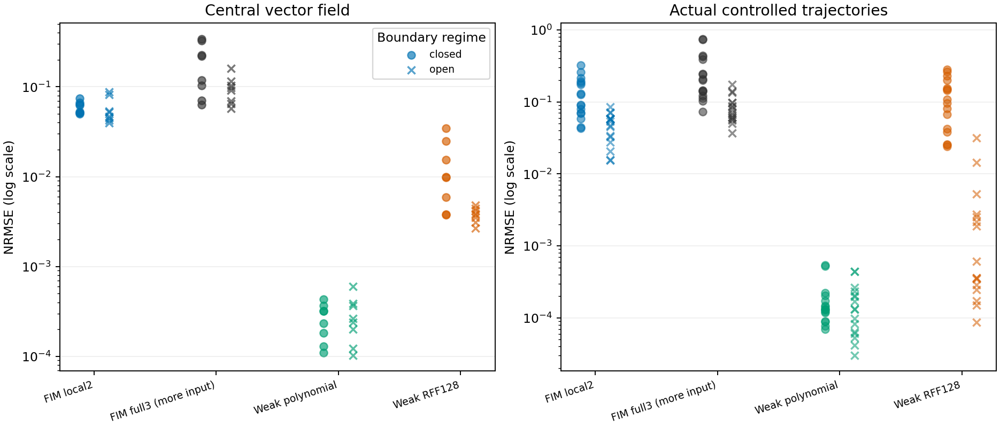

# C82：联合动力学先验能否复用为局部机制？

“局部不闭合就会使预训练场推断失效”没有得到当前实验支持。不能继续把这个解释当作既定研究缺口。 本轮接受最终方向0。已有模型的正面能力和强普通控制均完整保留。

## 研究问题与实际合同

低维FIM-ODE以闭合自主系统为原任务。更大系统里的局部邻域可能受外部变量驱动，但目标分量仍只依赖已观测的直接父变量。我们检查这两种条件是否必须同时满足。保持同一个目标f0(x0,x1)，只将邻居x1的外部驱动系数从0改成1.2。完整生成系统有三个状态，目标一阶导数严格不依赖第三状态。

这是四个相关多项式机制×两个初态bank×两种边界条件，共16个上下文任务，不是16个独立真实数据集。两种bank在不同机制间共用初态；没有用结果筛选方程或seed。每任务8条干净轨迹、每条256点、t∈[0,8]。先冻结协议再生成/推断。原预算C71和C81保留评估均未打开。

同一机制/bank的开放与闭合案例使用完全相同的256个评分查询。查询处在两个上下文点云的凸包内，且经过合并TRAIN坐标标准化后，距两侧点云都不超过0.1。此条件减少支持范围差异，但不等于密度匹配或一般可辨识性证明。查询真导数仅供评分。全部生成器和文件哈希保留。

四组固定方法：原生FIM局部2变量、原生FIM完整3变量、目标分量弱三次多项式和目标分量弱RFF128。完整3变量模型得到更多上下文，属于诊断组，不能凭它优于局部模型就归因。普通模型只拟合目标导数，不拟合邻居的闭合动力学；它们与局部FIM获得相同两变量上下文。

多项式库包含真实目标族，明确为source-informed参数辨识控制；RFF是另一个固定灵活控制。它们都不是新方法。每族3个ridge，以前192点拟合、最后65个可见上下文点作给定x1输入的中心状态轨迹验证，再用全部256点重拟合。共96个候选、32次最终弱模型拟合；每候选检查8条验证路径，共768次内部验证积分。没有神经训练，没有把真场或独立新输入计划作为选择信号。

## 全部汇总

Field NRMSE=目标导数RMSE/同组真实导数标准差。控制轨迹NRMSE用该参考轨迹的标准差，均只用于评分。两个量不能直接混为同一指标。

| Method | Closed field median | Open field median | Paired open/closed median | At least 2x worse | Controlled-rollout median | Complete rollouts |
|---|---:|---:|---:|---:|---:|---:|
| FIM_local2 | 0.05758045 | 0.04967039 | 0.828843 | 0/8 | 0.06425606 | 32/32 |
| FIM_full3_diagnostic | 0.16907955 | 0.09482413 | 0.640107 | 0/8 | 0.11716926 | 32/32 |
| weak_polynomial3 | 0.00027483 | 0.00025270 | 1.102993 | 0/8 | 0.00013280 | 32/32 |
| weak_rff128 | 0.00982537 | 0.00382364 | 0.381719 | 0/8 | 0.02481246 | 32/32 |

## 每个场结果

| Mechanism | Initial-state bank | Regime | FIM local2 | FIM full3 diagnostic | Weak polynomial3 | Weak RFF128 |
|---|---|---|---:|---:|---:|---:|
| 0 | 2026821 | closed | 0.05178437 | 0.34142499 | 0.00023213 | 0.00990585 |
| 0 | 2026821 | open | 0.05227987 | 0.09775737 | 0.00026457 | 0.00442025 |
| 0 | 2026822 | closed | 0.05259794 | 0.21952552 | 0.00010938 | 0.00374880 |
| 0 | 2026822 | open | 0.04484310 | 0.16047801 | 0.00010308 | 0.00268113 |
| 1 | 2026821 | closed | 0.06414146 | 0.11863357 | 0.00032077 | 0.00383457 |
| 1 | 2026821 | open | 0.04706091 | 0.09189089 | 0.00020065 | 0.00376450 |
| 1 | 2026822 | closed | 0.06632669 | 0.10405239 | 0.00018095 | 0.03463845 |
| 1 | 2026822 | open | 0.05340108 | 0.05714482 | 0.00024083 | 0.00388277 |
| 2 | 2026821 | closed | 0.07446289 | 0.32894674 | 0.00031753 | 0.02478783 |
| 2 | 2026821 | open | 0.04261327 | 0.11573784 | 0.00036606 | 0.00420924 |
| 2 | 2026822 | closed | 0.05167206 | 0.22617283 | 0.00012966 | 0.00974490 |
| 2 | 2026822 | open | 0.08155738 | 0.10390824 | 0.00012187 | 0.00309120 |
| 3 | 2026821 | closed | 0.04973887 | 0.07009933 | 0.00036538 | 0.00593801 |
| 3 | 2026821 | open | 0.08756207 | 0.06504100 | 0.00038957 | 0.00351815 |
| 3 | 2026822 | closed | 0.06256295 | 0.06281103 | 0.00042994 | 0.01532047 |
| 3 | 2026822 | open | 0.03987592 | 0.06992009 | 0.00060021 | 0.00480366 |

## 实际受控模拟

每个模型还在两条新的正弦/余弦输入计划下模拟中心变量，共128条结果。输入计划与初值在协议中预定；它们是do(x1(t)=u(t))条件，不是未来观测特征。完整3变量诊断在查询时固定x2=0，真实目标机制对它不敏感。RK45容差和失败保护对所有方法相同，参考用高精度DOP853。没有只报告导数拟合而省略实际模拟。

这仍是局部受控原语模拟。未运行高维自由网络、未知图发现、隐状态恢复、未知传感器转移，或对该系统做真实实验。不能把这里的2变量局部成功升级成一般高维世界模型已实现。

## 独立核验

原生2D/3D缓存与直接model_forward在17个查询完全一致；显式零补齐第三坐标与原生2D输入完全一致。32个原生场结果独立重放最大差0；全部64场记录、128控制轨迹的指标独立计算最大差0，共检查98560个预测/参考标量和568个身份数组。32个弱模型共2224个系数以逐窗口积分和augmented least squares复核，最大差1.41e-07。没有失败记录被丢弃。源70文件和权重结束后再次核验。

实际数值执行耗时483.57秒，CPU两线程、进程局部E-core affinity；固定OpenFIM commit `cee2bb53be1e8e92b73f98dfdbe3605efc9119cc`和HF基础权重revision `00875c253d025dd33fd70ae751089b1be3a7c174`，12,968,068参数未更新。数据和数组留在服务器15TB项目子目录，GitHub只上传代码、协议、紧凑结果、模型系数、日志、图和哈希；未同步本地载荷。

## 研究判断与下一项决定性问题

决策：`SIMPLE_CLOSURE_FAILURE_HYPOTHESIS_NOT_SUPPORTED`。C82并没有因C81失败就继续改同一模型；它检验了另一种可复用动力学能力。闭合先验可否作局部机制的答案应来自这些实际结果，而不是从任务假设直接推导失败。

即使局部推断成功，它与可扩展世界模型之间仍缺少证据：拼接很多局部场后，完整系统的误差、反馈稳定性、未见初态和干预传播是否保持？更大系统中，已知父图、样本数和局部模型的先验成本必须同强普通辨识控制对齐。此前CompNO/ICON和函数编码器已经覆盖模块组合，不能把简单拼接改名当新框架。当前结果只为下一次真正的高维组合实验提供资格化依据；没有完成创新性和独立改进空间验证。
