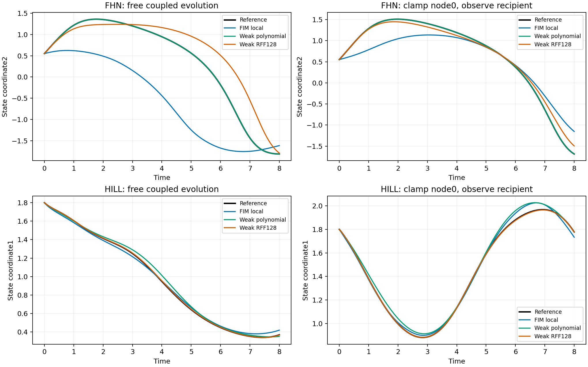

# C83 path-level attribution and research judgment

This analysis was specified after the first two tasks, then applied without changing any model, seed, initial condition, ridge selection or evaluation tolerance. It is post-screen diagnostic evidence, not a new method or independent confirmatory test.

| Family | Noise | Completed | Reference-path field defect | Predicted-path field defect | Reference support p95 | Predicted support p95 | Linearized error relative discrepancy | Linearized/actual cosine |
|---|---:|---:|---:|---:|---:|---:|---:|---:|
| fhn | 0.0 | 16/16 | 0.2357 | 0.269013 | 0.942718 | 0.957181 | 0.775017 | 0.779605 |
| fhn | 0.03 | 16/16 | 0.252325 | 0.296682 | 0.903227 | 0.934623 | 0.696713 | 0.820094 |
| hill | 0.0 | 16/16 | 0.193768 | 0.186621 | 0.324928 | 0.322524 | 0.532426 | 0.96208 |
| hill | 0.03 | 16/16 | 0.194151 | 0.185118 | 0.285723 | 0.287648 | 0.367975 | 0.961571 |

Field-defect scores use the standard deviation of the true field along the reference path, shared for reference/prediction queries. They differ from trajectory NRMSE and the context-query field score. Support distances are per-target standardized nearest-context distances, not guarantees of correct counterfactual inference. The linearized comparison uses true equations and future reference trajectories unavailable at deployment. A small discrepancy would support ordinary local sensitivity as an explanation; a large discrepancy can reflect nonlinear departure or interpolation/linearization approximation. Neither outcome automatically establishes a new research gap.

The extra interface test compares128-query evaluation,17-query prefixes, single-location solver calls, reversed queries and duplicate query sets. All16 checks pass at unchanged atol/rtol2e-5, maximum absolute discrepancy5.96046e-07. Therefore a target-query-set interaction is not an explanation of current field/rollout differences at this tolerance. The source decoder attends from each query to the observed context independently.

Attribution arrays, true equations and derived metrics were checked; 128 reference/predicted-path query groups (20672 scalars) were replayed with unchanged native fields, maximum absolute discrepancy1.66893e-06. The analytic Jacobians were checked against finite differences at64 initial reference points, maximum discrepancy4.27342e-10. These checks validate the described diagnostics, not a broad causal interpretation of their correlations.

## What is decided

Frozen C83 development decision: `GENERIC_LOCAL_FOUNDATION_COMPOSITION_ADVANTAGE_NOT_ESTABLISHED`. Generic stitching of the released local prior is not a qualified innovation. Classical ordinary identification and its explicit function-family information are retained as controls. A failed continuation gate retires this generic advantage claim; it does not prove all learned dynamics priors useless.

The narrower rescue hypothesis concerns synthetic-prior/neighbor-model mismatch. PRETRAINING_PRIOR_BOUNDARY83_V1.md verifies joint finite-trajectory filtering but does not establish its causal responsibility for these results. MODULAR_INFERENCE_BOUNDARY83_V1.md records that generic cuts and partial feedback control are already known. A decisive next attribution would compare matched joint and target-conditional inference with an ordinary exact/qualified posterior before any large training. This remains needs-mechanism/needs-evidence, not an accepted paper direction. FHN/Hill also differ in local parent count, so their contrast does not isolate a closure or prior-selection effect.

## Fixed illustrative trajectories

Indices were fixed as setting0, seed2026831, clean context and initial0 in both families; recipient coordinates2(FHN) and1(Hill). This is an illustrative choice, not a best/worst selection or a substitute for complete group statistics. INTERPRETATION_BOUNDARIES83_V1.md records the family/parent-count confounds. The plot does not clip finite values or map a solver failure to a numerical error value.

Observation-map transfer is only a different fallback; METAILAD_BOUNDARY83_V1.md checks the actual theorem assumptions without claiming its result covers arbitrary unseen sensors or is wrong outside its scope. No fallback experiment was launched in this cycle.

Qualified final research directions0. Overall research goal ACTIVE/UNACHIEVED. The correct response to these results is narrower causal attribution or retirement, not more architectures or a positive story manufactured from simulation counts.
