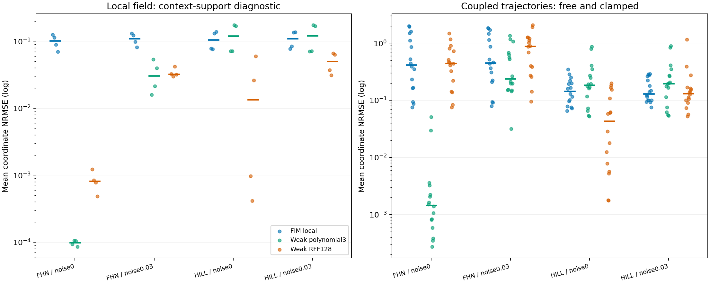

# C83 — Larger-system simulation from local inferred fields

Decision: `GENERIC_LOCAL_FOUNDATION_COMPOSITION_ADVANTAGE_NOT_ESTABLISHED`. The generic composition route has not demonstrated its required advantage over ordinary local identification. Do not promote stitching itself to a novel world-model mechanism. No final research direction is accepted.

## Research question and actual execution

Can a released low-dimensional field inference model, reused through target-specific local parent sets, form a larger autonomous simulator and propagate a prescribed intervention? C82 tested local primitives; this cycle actually composes a12-state coupled oscillator ring and a7-state nonlinear repression ring. There are two parameter settings in each family, two initial-context banks and clean/.03-noise conditions:16 tasks. Related settings and paired noise tasks are not16 independent datasets. Four context trajectories each have256 observations over[0,8].

All methods know physical coordinates and the same exact local parent graph. Ordinary polynomial regression is source-informed for the cubic oscillator family; fixed RFF128 supplies a different flexible control. Both fit weak state-increment equations and choose one ridge for the complete composed model from three candidates using observed-context coupled validation only. Refitting uses all256 observations. No future test state or derivative selects a model. FIM's large pretrained prior and its training cost are additional information, not a capacity/budget match.

Each composed model simulates two independently generated initial states under both free dynamics and `do(x0(t)=x0(0)+.5 sin(.8t))`. Nonintervened variables evolve under the fitted coupled field; no future factual state is supplied. Total192 trajectories,48 local-field records and96 paired intervention-response records. Fields are measured at128 context-union points and do not certify off-support accuracy. All finite medians below are accompanied by completion counts; task medians require every constituent simulation to complete.

## Results

The primary score averages per-coordinate RMSE/std(reference coordinate); clamped-coordinate0 is excluded. Field, trajectory and response denominators refer to different quantities and must not be interchanged. Noisy/clean conditions share clean trajectories; parameter settings share initial-state banks.

| Family | Noise | Method | Field median | Trajectory median (finite) | Task median (all complete) | Response median (finite) | Complete |
|---|---:|---|---:|---:|---:|---:|---:|
| fhn | 0.0 | FIM_local_composed | 0.101463 | 0.418251 | 0.445984 | 1.80216 | 16/16 |
| fhn | 0.0 | weak_polynomial3 | 9.89913e-05 | 0.00145865 | 0.00158626 | 0.0118006 | 16/16 |
| fhn | 0.0 | weak_rff128 | 0.000814428 | 0.443543 | 0.49286 | 1.1319 | 16/16 |
| fhn | 0.03 | FIM_local_composed | 0.110032 | 0.450301 | 0.476298 | 1.74269 | 16/16 |
| fhn | 0.03 | weak_polynomial3 | 0.0304738 | 0.238083 | 0.310548 | 0.866795 | 16/16 |
| fhn | 0.03 | weak_rff128 | 0.032186 | 0.882703 | 1.06475 | 1.53089 | 16/16 |
| hill | 0.0 | FIM_local_composed | 0.104852 | 0.144382 | 0.13313 | 0.166737 | 16/16 |
| hill | 0.0 | weak_polynomial3 | 0.120037 | 0.183458 | 0.164653 | 0.211171 | 16/16 |
| hill | 0.0 | weak_rff128 | 0.0135285 | 0.0433655 | 0.041079 | 0.0996369 | 16/16 |
| hill | 0.03 | FIM_local_composed | 0.109518 | 0.130374 | 0.140341 | 0.175815 | 16/16 |
| hill | 0.03 | weak_polynomial3 | 0.120462 | 0.196728 | 0.173912 | 0.204445 | 16/16 |
| hill | 0.03 | weak_rff128 | 0.0500337 | 0.131211 | 0.138801 | 0.166092 | 16/16 |

Failed or incomplete trajectories: 0. All failure messages and partial/empty arrays remain in raw server artifacts and compact result records. True-field evaluation-solver checks cover64 trajectories; maximum coordinate-mean NRMSE is0.00116314. Hence the reference/evaluation solver mismatch is measured rather than assumed negligible.

## Attribution and limitations

Local field error, global rollout error, paired intervention-response error and support-distance diagnostics are distinct evidence. Context-neighbor distances are descriptive; they do not prove identifiability or isolate distribution shift from feedback amplification. This screen cannot settle latent-state recovery, graph discovery, unseen sensors, unknown interventions or real-data transfer. We do not infer failure from crossing the model's original3D task limit alone. Existing modular/meta-learning and operator-composition work already covers generic composition. Native UNICON/GICON/CHOP were inspected, not executed; no claim of outperforming those methods is made.

No original-paper table reproduction is asserted. Zero neural weight updates were performed. Independent native batch qualification covers every local target in both families at17 points with the original helper. End-to-end native field replay passes on all16 tasks. Original70 source files and exact checkpoint hashes were checked before/after execution.

## Verification and reproducibility

Independent vectorized true equations reproduce context and reference trajectories, maximum reference-coordinate discrepancy1.74949e-12. All336 score records were independently recomputed, maximum difference0; 1054272 prediction/target scalars checked. Selected ordinary coefficients use separate per-window quadrature and augmented least-squares verification: 304 local models,21608 coefficients; maximum discrepancy7.03648e-08. Failed candidates remain visible.

Numerical screen wall time2442.70s, CPU two threads with process-local E-core affinity; no shared runtime packages, hardware settings or unrelated jobs changed. All context, model and prediction payloads remain on server15TB storage. GitHub receives source, protocol, hashes, compact results, logs and this figure; no result payload synchronization to the local machine.

## Next decisive experiment

If the gate passes, test unseen mechanism families and system sizes under equal-information ordinary graph/identification baselines, then compare relevant native operator methods under compatible contracts. If it fails, retain this negative capability evidence and diagnose whether a differentiated uncertainty/transfer mechanism exists before adding architecture. Local-model composition alone is not a research contribution. The separate original-budget modular-meta-learning campaign continues without early reserved evaluation. Overall ACTIVE/UNACHIEVED.
