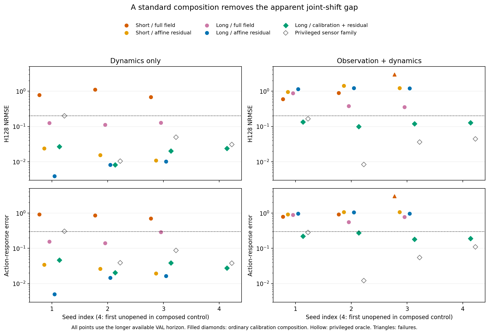
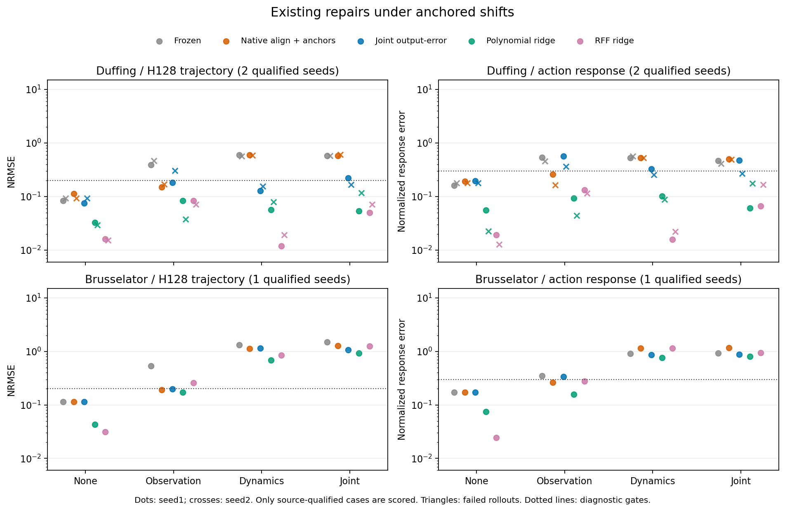
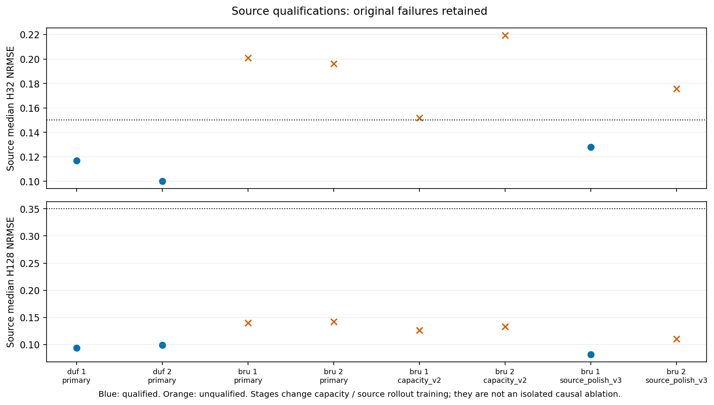

# C85 final judgment: ordinary composition repairs the apparent gap

## Decisive additional existing-method control

**The proposed necessity of a new calibration mechanism is rejected in this controlled subcase.** A standard calibration followed by source-field affine-residual identification, selected using VAL H128, passes the unchanged trajectory/action-response/no-failure gates in 16/16 Brusselator cases, including all 4/4 joint-change seeds. Seed2026854 was unopened before this control; the preceding three seeds are post-screen development evidence. No new method or final research direction has been validated.

| Seed | Condition | Ordinary H128 NRMSE | Ordinary response | Ordinary gate | Oracle H128 / response |
|---:|---|---:|---:|---|---|
| 2026851 | none | 0.0179657 | 0.00995844 | PASS | 0.0402477 / 0.0424138 |
| 2026851 | observation | 0.0293994 | 0.0280913 | PASS | 0.0387565 / 0.037651 |
| 2026851 | dynamics | 0.0270853 | 0.0463643 | PASS | 0.200185 / 0.304077 |
| 2026851 | joint | 0.133382 | 0.219368 | PASS | 0.1648 / 0.281869 |
| 2026852 | none | 0.0102568 | 0.00468822 | PASS | 0.0127806 / 0.00643444 |
| 2026852 | observation | 0.0389988 | 0.0295815 | PASS | 0.0104368 / 0.00525414 |
| 2026852 | dynamics | 0.00821546 | 0.0204162 | PASS | 0.0104185 / 0.0389572 |
| 2026852 | joint | 0.0991851 | 0.276196 | PASS | 0.00838208 / 0.012166 |
| 2026853 | none | 0.0127687 | 0.00528413 | PASS | 0.0141721 / 0.0169951 |
| 2026853 | observation | 0.0339569 | 0.0303462 | PASS | 0.0111841 / 0.0113727 |
| 2026853 | dynamics | 0.0201304 | 0.0385708 | PASS | 0.0496525 / 0.0873281 |
| 2026853 | joint | 0.12048 | 0.179933 | PASS | 0.0361754 / 0.0547776 |
| 2026854 | none | 0.0129658 | 0.00799876 | PASS | 0.0107699 / 0.0138907 |
| 2026854 | observation | 0.0275786 | 0.0256707 | PASS | 0.0147993 / 0.022273 |
| 2026854 | dynamics | 0.0239077 | 0.0277191 | PASS | 0.030832 / 0.0379394 |
| 2026854 | joint | 0.126925 | 0.188589 | PASS | 0.0444116 / 0.109594 |

This is not a test-selected best-of-methods result: the entire ordinary calibration/field configuration is selected on VAL before EVAL is generated. Main selection uses the available128-step VAL trajectory; diagnostic H32 selections, oracle results and every failure are also retained in the machine-readable evidence. A source field is first qualified on source VAL. Degree-three features suit this small fully observed system; the result is not universal superiority over latent world models.

### What the successive controls excluded

The original screen passed10/12 scored neural-source cases. Its two unresolved Brusselator dynamics/joint conditions were followed by standard weak-form regression: this did not repair the changed dynamics in either seed. A same256/128-transition-budget allocation control compared four64-step versus two128-step TRAIN paths, and two64-step versus one128-step VAL paths. Standard affine residual updates in source coordinates repaired dynamics-only errors; the tested raw-observation fits still failed joint changes on all three seeds. These are post-screen attribution controls, not independent confirmations of a novel gap.

A privileged physical-state coverage diagnostic found about97.9–98.1% of changed-dynamics EVAL states outside the convex hull of the eight static calibration anchors. The diagnostic never entered fitting or model selection. Convex-hull membership is neither an identifiability certificate nor proof that calibration must fail. The composed ordinary baseline subsequently succeeded despite this extrapolation, invalidating a necessity argument based on the earlier failures.

The final composition fits bidirectional affine or affine-plus-RBF calibration on only the same eight anchors, transforms target TRAIN into source coordinates, then fits the already tested weak source-field/affine residual. It uses the long allocation already described, not additional transitions or true target states/equations. Frozen-field options are allowed. Thus this result does not isolate calibration alone as a causal factor relative to the original screen, which also differed in source architecture and selection horizon; it establishes that an available existing repair suffices under the stated information/budget contract.

The family oracle knows the functional form of the sensor generator but estimates its parameters from the same eight anchors. It is explicitly privileged and never included in the ordinary16/16 count. Its worse seed1 dynamics score is retained; the oracle label is not a guarantee of optimal finite-sample estimation.

### Execution and verification

The first composed capture completed seeds1/2 and stopped before seed3 on an immutable-source-file creation error. The second source version reads that existing source and runs only seeds3/4 in a fresh folder. Both source versions, failure-log hash, completed records and exit statuses are retained. No scientific grid or gate changed in this repair.

Weak, factorial and composed checks independently verify 720896 additional prediction scalars and 7040 metric rows. Source/residual coefficients are checked by augmented least squares, paired calibrations are re-fitted, simulations and scores reimplemented, and physical reference paths compared with DOP853. These counts describe correlated numerical checks, not independent tasks or evidence strength. See the published verification records, case hashes and pre-EVAL seals. All raw arrays, weights and logs remain on the server.

**Next decision:** retire this candidate as a reason to invent a new mechanism in these fixtures. Harder observation or dynamics settings are not automatically new research gaps. Any replacement needs a concrete scientific requirement, competent inference/identification baselines, a differentiator from existing world-model adaptation, and held-out evidence. Overall research objective remains ACTIVE / UNACHIEVED; accepted directions0.

# C85 results: existing repairs in an anchored controlled subcase

Completed cases: 12 /16. A repair chosen using target VAL alone satisfies the frozen H128 trajectory and action-response criteria in 10/12 completed cases. Qualified new research directions:0. No new method was trained.

| Family | Seed | Change | Validation-selected existing repair | H128 NRMSE | Response error | Gate |
|---|---:|---|---|---:|---:|---|
| brusselator | 2026851 | none | rff128 | 0.0311749 | 0.0243396 | PASS |
| brusselator | 2026851 | observation | polynomial3 | 0.173157 | 0.157886 | PASS |
| brusselator | 2026851 | dynamics | polynomial3 | 0.679057 | 0.763212 | UNRESOLVED |
| brusselator | 2026851 | joint | polynomial3 | 0.93138 | 0.7998 | UNRESOLVED |
| duffing | 2026851 | none | polynomial3 | 0.0326597 | 0.0553172 | PASS |
| duffing | 2026851 | observation | polynomial3 | 0.0830867 | 0.0923111 | PASS |
| duffing | 2026851 | dynamics | polynomial3 | 0.056974 | 0.101805 | PASS |
| duffing | 2026851 | joint | polynomial3 | 0.053696 | 0.060966 | PASS |
| duffing | 2026852 | none | rff128 | 0.0152021 | 0.0126986 | PASS |
| duffing | 2026852 | observation | polynomial3 | 0.0379071 | 0.0441144 | PASS |
| duffing | 2026852 | dynamics | rff128 | 0.0190243 | 0.0220802 | PASS |
| duffing | 2026852 | joint | rff128 | 0.0705987 | 0.167254 | PASS |

The full five-method table is machine-readable in evidence/CASE_SUMMARIES85_PUBLIC_V1.json; all 2400 metric rows are retained. There are 960 model/plan simulation runs and 480 scored action contrasts, not that many independent scientific tasks. Plans and physical trajectories are shared across methods and paired change conditions. H32 scores reuse trajectory prefixes and the two plans share their first32 steps.

## Source training and controls

The original64-wide/2-latent sources qualified on Duffing but not Brusselator. Larger128-wide/4-latent source fits also failed the unchanged short-horizon gate. A separately documented source-only32-step output-training control used the same data and unchanged qualification thresholds before any Brusselator EVAL generation. All ancestor failures and additional training costs are retained. Changing capacity, learning rate, optimizer state and source loss horizon is not an isolated causal ablation of any one factor.

There are 8 source training records: four original fits, two capacity fits and 2 source continuations, over four family/seed cells. Actual selected and completed update counts and parameter counts are in evidence/SOURCE_CONTROLS85_PUBLIC_V1.json. The source sizes and objectives differ by family; this is not a matched-compute architecture comparison.

## Verification and interpretation

All selected neural/dictionary predictions were replayed; 245760 prediction scalars were checked, scores independently recomputed, selected ridge coefficients checked with augmented least squares, and physical trajectories checked with independently implemented DOP853 dynamics. No model was reselected on EVAL. Prediction and source-checkpoint verification records are published, including failed source ancestors.

The ordinary controls use a low-dimensional fully observed state, and degree-three features are favorable to these dynamics. The sensor mapping is nonlinear and withheld from models, but remains invertible. These conditions differ materially from hidden-state, high-dimensional and universal cross-family modeling. Neither successful ordinary repairs nor a poor neural score establishes a universal result. A native aligner failing after actual dynamics change is outside its frozen-dynamics premise.

This screen does not establish a need for a new calibration mechanism in cases passed by existing repairs. Unresolved cases require source, coverage, observability, objective and model-selection analysis before becoming gap evidence. Overall research goal remains ACTIVE / UNACHIEVED.
