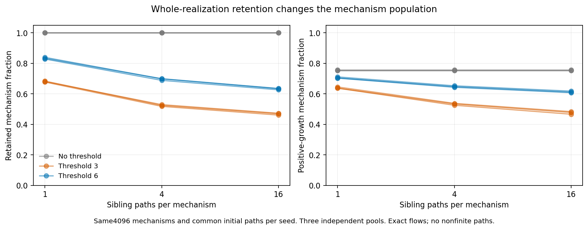
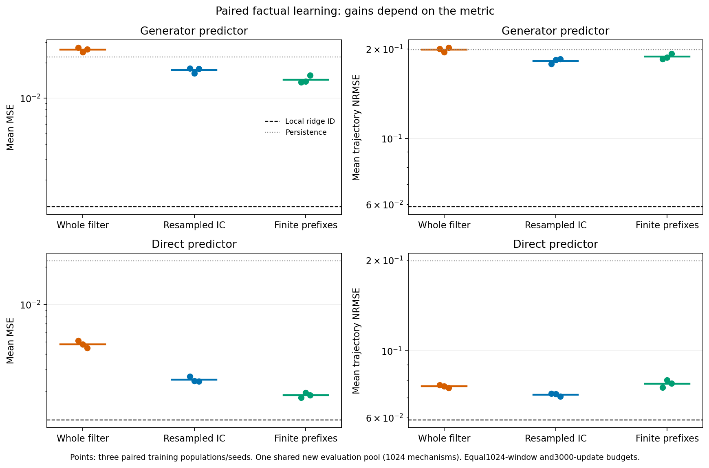
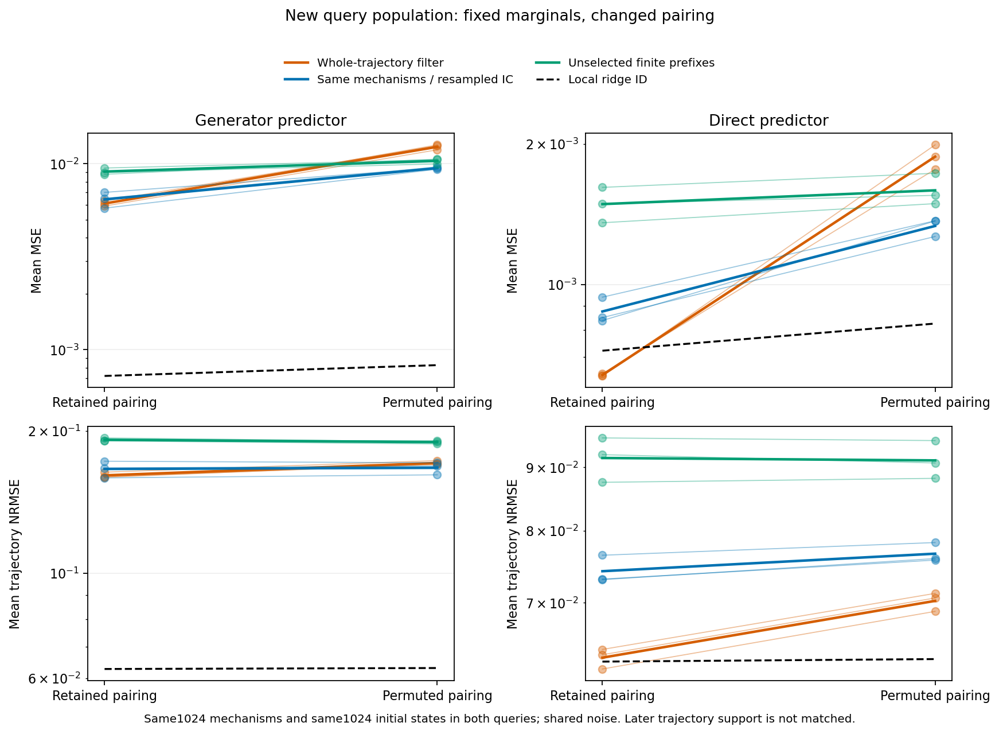

# C86: a sampling effect is verified; a new world-model method is not

The pinned whole-realization retention rule changes the mechanism population even when every path is finite. In a paired small-model study, resampling initial conditions while holding selected mechanism IDs fixed improves unselected-query raw MSE across both tested architectures and all three training seeds. That benefit is not universal: retained-cohort errors can rise, and on crossed queries the direct predictor's normalized errors worsen despite lower raw MSE. Ordinary local ridge identification is stronger than the neural models on the unselected pool. Final accepted directions:0.

## Sampler intervention

Three pools contain4096 mechanisms each. Nine paired conditions vary sibling count1/4/16 and thresholdNone/3/6, with identical underlying mechanisms and prefix paths. All physical flows are finite, so the threshold effect is separate from numerical failure. The actual retained PathGenerator.solve_equations body is executed, but its solver is explicitly replaced by exact linear flow. This does not reproduce the full FIM generator or its checkpoint pretraining population. Public source SHA and method AST are independently verified.

For independent initial states, the accepted mechanism density is proportional to its original density times the single-path acceptance probability raised to the sibling count. This elementary selection identity is not novel theory. A weak snapshot-only probe shows a small selected-only association in some conditions, not a trained world model's actual shortcut.

## Matched-budget factual learning

| Architecture | Train seed | Whole MSE | Resampled-IC MSE | Prefix MSE | Whole mean NRMSE | Resampled mean NRMSE | Prefix mean NRMSE |
|---|---:|---:|---:|---:|---:|---:|---:|
| generator | 2026861 | 0.02693932 | 0.01795152 | 0.01368741 | 0.1997719 | 0.1782156 | 0.1848958 |
| generator | 2026862 | 0.02464029 | 0.01625368 | 0.0138573 | 0.1949555 | 0.1836352 | 0.187146 |
| generator | 2026863 | 0.02620716 | 0.01782423 | 0.01559445 | 0.2016785 | 0.1845125 | 0.1924871 |
| direct | 2026861 | 0.005128138 | 0.002634752 | 0.001785717 | 0.07707831 | 0.07207686 | 0.07558931 |
| direct | 2026862 | 0.004799298 | 0.002428235 | 0.001946421 | 0.07630369 | 0.07185404 | 0.0799391 |
| direct | 2026863 | 0.00446333 | 0.002409043 | 0.001866915 | 0.0753597 | 0.07062889 | 0.07783825 |

All18 fits beat persistence on their own source VAL population. This is a weak competence check: it does not establish convergence or equal architecture quality. 17/18 fits improve their source VAL minimum by more than0.5% in the last600 updates. Selected/completed costs and every checkpoint trace are retained. The generator architecture has a family-specific symmetric-linear transition assumption and still trails the direct predictor; do not turn this into a general architecture ranking.

Both architectures receive the same1024 retained short windows and3000 updates per arm, with matched initialization and index schedules. The resampled-IC arm preserves whole-filter mechanism IDs and changes their initial-condition pairing. Prefix retention changes the mechanism population as well. Simulator-attempt budgets and physical state distributions are not matched. New evaluation seed2026864 contains1024 common mechanisms, including701 that satisfy the original complete-path filter and323 that do not. Those subgroup labels use privileged future information for diagnosis only; they are never fitter inputs or selection criteria.

The ordinary control's unselected mean MSE is 0.0011786784, with mean NRMSE 0.058944346. All three source-selected ridge values coincide, so they form one effective prediction baseline, not three independent successes. Prefix retention improves raw MSE but does not consistently improve average per-trajectory NRMSE; both metrics and all subgroups are retained.

## Fixed marginals, changed pairing

The second new seed2026865 supplies1024 mechanisms and their original accepted initial states. Permuting those same initial states keeps both marginals exactly fixed and changes their joint association. Identical noise is reused. Later trajectory support and available information can differ, so this is not a full-support match. No model is retrained or reselected. Lower crossed raw MSE for resampled-IC training accompanies worse direct-predictor NRMSE; this tradeoff prevents a universal robustness claim.

## Verification, scope and decision

Independent NumPy networks replay all neural predictions; independent least squares replays ordinary controls. All198 source-checkpoint losses and data/selection hashes are checked. Physical paths are compared with SciPy matrix exponentials. Verified prediction scalars:2162688; sampler trajectory scalars:31850496. These are numerical-check counts, not independent scientific tasks. Three paired training seeds share each of two evaluation pools. Individual trajectories do not turn this into multiple unrelated datasets.

No released foundation-model checkpoint is tested in this cycle, and the exact FIM-ODE pretraining-data lineage remains unverified. The inspected source is an SDE/ODE data-generation sampler, not proof of a particular checkpoint's history. Therefore no original-paper error, causal attribution of C83 failures, posterior-calibration theorem, new architecture requirement or final research direction is claimed.

The candidate is now specifically about training-sampler selection and mechanism/initial-state dependence, rather than generic poor forecasting. Censored identification, validity correction in simulation-based inference, initial-state resampling and controlled-generator audits are prior art. A possible new contribution would need actual native world-model evidence of a non-ignorable selection/coarsening interaction and a robust correction under clear budget constraints. Read PRIOR_ART_AND_REPAIRS86_V1.md and final_research_direction.md before extending it. Overall research objective remains ACTIVE / UNACHIEVED.
